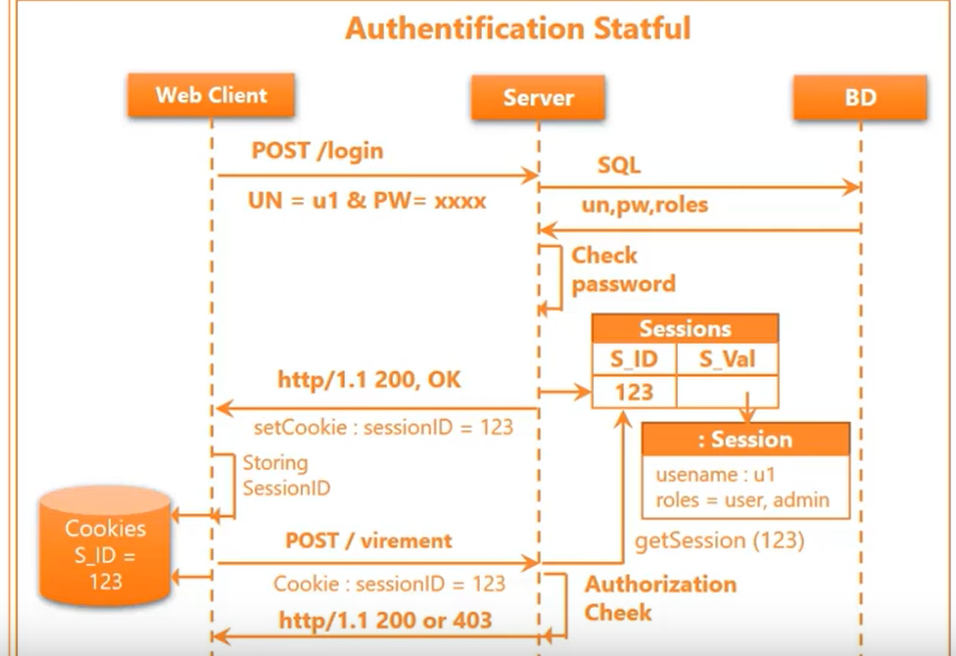
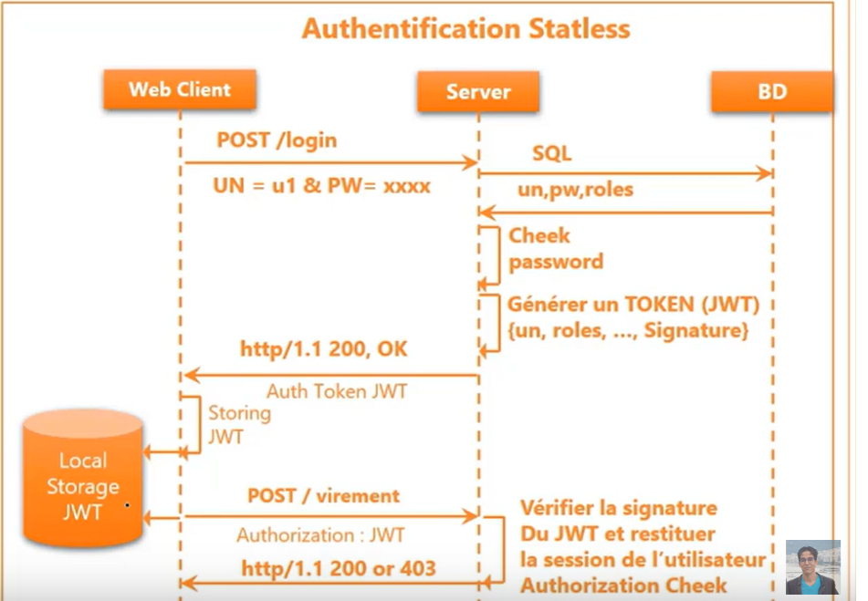

# Spring Security

[Cours youtube](https://www.youtube.com/watch?v=3q3w-RT1sg0&ab_channel=ProfesseurMohamedYOUSSFI)

## Resumer des systèmes d'authentification


### Tableau 1 : Stateful



### Tableau 2 : Stateless



## Faille de sécurité CSRF

### Problème :


### Une solution :


## Une autre solution : JWT


## Utilisation de Spring Security

Spring security génère une page d'authentification (en communiquant le mot de passe en console).
Ensuite, il cntourne la faille de sécurité CSRF en mettant en place le jeton de sécurité (d'ou la raison pour laquelle la page est bloquée).

Pour avoir la main sur la configuration (dans le cas ou on utilise une stratégie stateless),
on créé un fichier `SecurityConfiguration` pour personnaliser les paramètres de la méthode `configure()` :


`.permitAll()` Pour authoriser toutes URL

`.csrf(...)` Pour désactiver le csrf

`.header(...)` Dans lequel se trouve frameOption, qu'il faut désactiver aussi (dans le cas de l'utilisation de H2 DB)

`.formLogin()` Génère un formulaire d'authentification

### l'interface UserDetailsService

L’interface UserDetailsService est le point d’entrée standard que Spring Security utilise pour récupérer les
informations d’un utilisateur (nom, mot de passe, rôles, etc.) lors de l’authentification.

Spring Security appelle cette méthode pour :

- Trouver l’utilisateur dans ta base de données (ou autre source).

- Retourner un objet UserDetails contenant les infos nécessaires à l’authentification.

```java
UserDetails loadUserByUsername(String username) throws UsernameNotFoundException;
```

## Stateless : implémenter JWT


Conformément au diagram, pour implémenter JWT, on va devoir manipuler 2 méthodes importantes (qu'il va falloir surcharger) :

- ``attemptAuthentication`` Lorsque l'utilisateur tente de s'authentifier
- ``successfulAuthentication`` Une foi l'utilisateur authentifié

Pour cela, on créé une class qui hérite de la class `UsernamePasswordAuthenticationFilter` :

```java
public class JwtAuthenticationFilter extends UsernamePasswordAuthenticationFilter {
    @Override
    public Authentication attemptAuthentication(HttpServletRequest request, HttpServletResponse response) throws AuthenticationException {
    }

    @Override
    protected void successfulAuthentication(HttpServletRequest request, HttpServletResponse response, FilterChain chain, Authentication authResult) throws IOException, ServletException {
    }
}
```

Dans `successfulAuthentication` on génère le jeton `jwt` :

```java
User user = (User) authResult.getPrincipal();
Algorithm algorithm = Algorithm.HMAC256("mySecret1234");
String jwtAccessToken = JWT.create()
        .withSubject(user.getUsername())
        .withExpiresAt(new Date(System.currentTimeMillis() + 5 * 60 * 1000))
        .withIssuer(request.getRequestURL().toString())
        .withClaim("roles", user.getAuthorities().stream().map(ga -> ga.toString()).collect(Collectors.toList()))
        .sign(algorithm);

response.setHeader("Authorization", jwtAccessToken);
```

Pour tester :

Methode : POST, URL : `{url}/login`,

avec un body au format `x-www-form-urlencoded`.

En retour, dans le header de la réponse, on a un JWT dans le champ `Authorization`.

### Gestion de la révocation du token

**Problème** : Une fois que l'on génère un token qui expire dans 30 jours, rien n'empêche l'utilisateur d'accéder à l'application durant toute cette période.

**Solution** : Utilisation de 2 token ``Access Token`` & ``Refresh token`` :

#### 🔐 Access Token : le passeport temporaire

- Durée de vie courte : souvent entre 15 minutes et 1 heure.

- Contient les permissions (scopes) : ce que l’utilisateur est autorisé à faire.

- Utilisé pour accéder aux ressources : chaque requête vers une API inclut cet access token.

- Format JWT : il est autoportant, signé, et peut être vérifié sans requête à la base de données.

**⚠️ S’il est volé, l’attaquant peut accéder aux ressources jusqu’à expiration.**

#### 🔁 Refresh Token : le ticket de renouvellement
- Durée de vie longue : plusieurs jours, voire semaines.

- Utilisé pour obtenir un nouvel access token sans que l’utilisateur se reconnecte.

- Stocké de manière sécurisée : souvent côté serveur ou dans un cookie httpOnly.

- Peut être révoqué : contrairement à l’access token, il est souvent stocké en base et donc traçable.

**🎯 Il permet de maintenir une session fluide sans compromettre la sécurité.**


L’access token est comme une carte d’accès temporaire, 
tandis que le refresh token est le mécanisme qui permet de prolonger cette carte sans redemander l’identité à chaque fois. 
Ce duo permet de concilier sécurité stricte et fluidité d’usage.

### JWT Authorization filter


Lorsque l'on demande une ressource via REST, l'application doit vérifier l'autorisation, via la manipulation du Bearer token.

Pour mettre en place cette feature, on doit créer une classe qui hérite de `OncePerRequestFilter`, 
il s'agit d'une méthode qui est invoqué une fois qu'une requete arrive dans le serveur.


```java
public class JwtAuthorizationFilter extends OncePerRequestFilter { 
    @Override
    protected void doFilterInternal(HttpServletRequest request, HttpServletResponse response, FilterChain filterChain) throws ServletException, IOException {
        // On récupère le Bearer
        // On décode le token
        // On set l'utilisateur
    }
}
```

Sans oublier d'ajouter cette méthode en guise de filtre dans la configuration principale de la classe `SecurityConfiguration` :

```java
@Bean
public SecurityFilterChain filterChain(HttpSecurity http, AuthenticationConfiguration authenticationConfiguration) throws Exception {
   ...
        .addFilterBefore(new JwtAuthorizationFilter(), UsernamePasswordAuthenticationFilter.class);

}
```

Et maintenant, je peux accéder aux ressources de l'application, ex :

``GET /users`` (avec le Bearer token dans le champs Authorization du header de la requete).

### Gestion des roles

Dans mon application, je dois être admin pour accéder à certaines requetes et user pour d'autres.

Comment faire ?

#### 1re méthode

```java
    @Bean
    public SecurityFilterChain filterChain(HttpSecurity http, AuthenticationConfiguration authenticationConfiguration) throws Exception {
        http
                .authorizeHttpRequests((authz) -> authz.requestMatchers(HttpMethod.GET, "/users/**").hasAuthority("USER"))
                .authorizeHttpRequests((authz) -> authz.requestMatchers(HttpMethod.POST, "/users/**").hasAuthority("ADMIN"))
```

#### 2e méthode 

En ajoutant des annotation aux méthodes (controller ou service) :

```java
@PostAuthorize("hasAuthority('ADMIN')")
@PostMapping("/users")
public AppUser register(@RequestBody UserForm userForm) { }

//

@PostAuthorize("hasAuthority('USER')")
@GetMapping("/users")
public List<AppUser> userList() { }
```

Sans oublier d'ajouter l'annotation suivante dans la class root :

```java
@EnableMethodSecurity(prePostEnabled = true, securedEnabled = true)
public class SpringSecurityApplication { }
```

Maintenant chaque controller/service peut être filtré en fonction du ou des roles de l'utilisateur.


### Refresh token

En cas d'expiration du token d'accès, on a 2 solution :

- S'autentifier (mauvaise solution).
- On utilise le refresh token pour en générer un nouveau.

On le fait via le controller :

```java
@GetMapping("/refreshToken")
public void refreshToken(HttpServletRequest request, HttpServletResponse response) throws IOException { }
```

Ceci permet de générer un nouveau access token à chaque fois qu'il a expiré.


### Problématique :

Cette application fonctionne avec Postman, mais a un problème lorsqu'il s'agit d'un navigateur. Le cookie n'est pas récupéré lorsqu'on appelle `/refreshToken`.